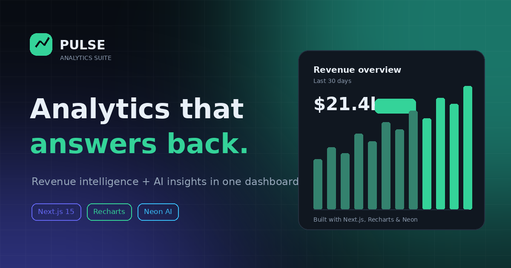

# Pulse — AI-Powered Analytics Dashboard

> A polished SaaS analytics product that doesn't just show numbers — it explains them.


**🚀 Live demo:** [pulse-analytics-three.vercel.app](https://pulse-analytics-three.vercel.app)

---

## ✨ What it does

Pulse is a full-stack, responsive analytics dashboard for a subscription business. It combines a clean data UI with an AI analyst that reads the live metrics and returns plain-English growth insights.

- **KPI cards** — revenue, active users, conversion, AOV — each with delta and sparkline
- **Revenue chart** — actual vs target with an interactive area chart and gradient fill
- **Date ranges** — 7D / 30D / 90D switching through a typed API route
- **Traffic donut** — channel mix with a highlighted top source
- **Transactions table** — plan, amount, status and date with responsive scrolling
- **AI Insights panel** — asks questions about the data and returns grounded answers
- **Zero-config demo** — deterministic seeded data means it works on first run
- **Production ready** — typed API routes, health check, env validation by absence, lint + typecheck scripts

## 🛠️ Tech stack

| Layer | Choice |
|---|---|
| Framework | Next.js 15 (App Router, React 19) |
| Language | TypeScript (strict) |
| Styling | Tailwind CSS v4 |
| Charts | Recharts 3 |
| Icons | Lucide React |
| Database | Neon Postgres (`@neondatabase/serverless`) — optional |
| AI | Neon AI Gateway (OpenAI-compatible chat completions) |
| Linting | ESLint 9 |

## 🚀 Run locally

```bash
git clone https://github.com/<your-username>/pulse-analytics.git
cd pulse-analytics
npm install
cp .env.example .env.local   # optional
npm run dev
```

Open [http://localhost:3000](http://localhost:3000). No keys required — the app falls back to built-in demo data and a deterministic insight engine.

## 🔌 Environment (all optional)

| Variable | Purpose |
|---|---|
| `DATABASE_URL` | Neon Postgres connection string; enables `/api/health` DB check |
| `NEON_AI_GATEWAY_BASE_URL` | Bare branch host from Neon Console → Connect → AI Gateway |
| `NEON_AI_GATEWAY_TOKEN` | Gateway credential (`nt_live_...`) |
| `NEON_AI_GATEWAY_MODEL` | Defaults to `gpt-5-mini` |

Without the gateway variables the AI panel keeps working using `src/lib/insights.ts`, so a demo never breaks in front of a client.

### Optional database setup

```bash
psql "$DATABASE_URL" -f scripts/seed.sql
```

The SQL creates `customers`, `transactions`, `sessions`, plus `daily_revenue` and `traffic_sources` views.

## 📡 API

| Endpoint | Description |
|---|---|
| `GET /api/metrics?range=7d\|30d\|90d` | Dashboard payload (KPIs, chart, traffic, activity) |
| `POST /api/insights` | AI or built-in insights. Body: `{ data, question? }` |
| `GET /api/health` | Service status and database connectivity |

## 📁 Structure

```
src/
├── app/
│   ├── api/{insights,metrics,health}/route.ts
│   ├── globals.css
│   ├── layout.tsx
│   └── page.tsx
├── components/
│   ├── AiInsights.tsx
│   ├── Dashboard.tsx
│   ├── Sidebar.tsx
│   └── Topbar.tsx
└── lib/
    ├── data.ts        # deterministic demo dataset
    ├── db.ts          # optional Neon connection check
    ├── insights.ts    # built-in analyst fallback
    └── types.ts
scripts/seed.sql
```

## 🎯 Portfolio blurb

> Built Pulse, a full-stack SaaS analytics dashboard in Next.js 15 and TypeScript. Added interactive revenue/traffic visualisations, range-filtered API routes, and an AI insight engine backed by Neon AI Gateway with a graceful offline fallback. Shipped with a responsive Tailwind v4 dark UI, seeded Postgres schema, health check and complete documentation.

## 📸 Cover



Regenerate it anytime with `python3 scripts/generate_cover.py`. Run `npm run dev` and capture the live dashboard at desktop and mobile widths for additional portfolio shots.

## ✅ Quality checks

```bash
npm run lint
npm run typecheck
npm run build
```

## License

MIT — free to use for personal and commercial projects.
